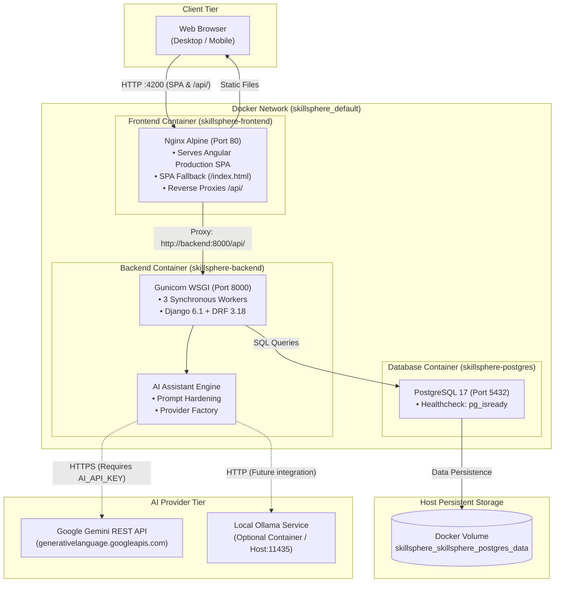

# SkillSphere

> **Intelligent, Role-Based Course Platform & Learning Management System (LMS)**

[](https://angular.dev/)
[](https://www.djangoproject.com/)
[](https://www.django-rest-framework.org/)
[](https://www.postgresql.org/)
[](https://www.docker.com/)
[](https://nginx.org/)
[](https://www.python.org/)
[](https://www.typescriptlang.org/)

SkillSphere is a full-stack, enterprise-grade Learning Management System engineered with an **Angular 20** standalone component frontend, a **Django REST Framework** backend, and a production-style **Docker Compose** container architecture.

The platform provides role-based learning workflows for Students, Instructors, and Administrators, complete with curriculum progression, interactive multiple-choice quizzes, automated certificate generation with public cryptographic verification, student reviews, in-app notifications, and a context-grounded **AI Learning Assistant**.

---

## Table of Contents

- [Overview and Problem Statement](#overview-and-problem-statement)
- [Key Features](#key-features)
  - [Student Learning Experience](#student-learning-experience)
  - [Instructor Authoring Studio](#instructor-authoring-studio)
  - [Administrative Governance](#administrative-governance)
  - [AI Learning Assistant](#ai-learning-assistant)
- [System Architecture](#system-architecture)
- [Technology Stack](#technology-stack)
- [Role-Based Access Control (RBAC)](#role-based-access-control-rbac)
- [Screenshots & Demo](#screenshots--demo)
- [Getting Started & Prerequisites](#getting-started--prerequisites)
- [Docker Compose Quick Start (Recommended)](#docker-compose-quick-start-recommended)
- [Local Host Development Setup](#local-host-development-setup)
- [Environment Configuration & Secrets](#environment-configuration--secrets)
- [Application URLs & Verified API Endpoints](#application-urls--verified-api-endpoints)
- [Database Persistence & Migration Guidance](#database-persistence--migration-guidance)
- [Automated Testing](#automated-testing)
- [Security Considerations & Current Limitations](#security-considerations--current-limitations)
- [Public Production Deployment Considerations](#public-production-deployment-considerations)
- [Troubleshooting Common Issues](#troubleshooting-common-issues)
- [Project Directory Structure](#project-directory-structure)
- [Roadmap & Future Enhancements](#roadmap--future-enhancements)
- [Contributing](#contributing)
- [License](#license)
- [Detailed Component Documentation](#detailed-component-documentation)

---

## Overview and Problem Statement

Modern online learning platforms frequently suffer from fragmented user interfaces, disconnected evaluation systems, rigid lesson delivery, and opaque progress tracking.

SkillSphere addresses these challenges by unifying modern software architecture with pedagogical workflows:
- **Responsive Single Page Application**: Fast client-side rendering with Angular 20 standalone components, fine-grained reactivity using Signals, and zero-reload navigation.
- **Robust REST API**: Modular Django REST Framework architecture adhering to standardized error formatting, strict validation, and stateless JWT authentication.
- **Deterministic Assessment**: Automated quiz evaluations with threshold scoring, attempt histories, and tamper-resistant certificate generation.
- **Pedagogical AI Integration**: A lesson-aware AI Learning Assistant grounded in current educational material, reinforced by prompt-injection defense boundaries.

---

## Key Features

### Student Learning Experience
- **Interactive Course Player**: Immersive lesson delivery supporting video embeds, structured Markdown content, adjacent lesson navigation, and completion tracking.
- **Dynamic Course Catalog**: Searchable and categorized course listings with syllabus previews, instructor credentials, and single-click enrollment.
- **Assessments & Quizzes**: Timed multiple-choice quizzes, automatic scoring, pass/fail status, and comprehensive attempt review breakdowns.
- **Verified Certificates**: Automatic issuance of downloadable certificates upon 100% course completion and passing quiz score, featuring unique UUIDs for public verification.
- **Student Dashboard**: Real-time progress indicators, enrolled courses, quick-resume triggers, and earned credentials overview.
- **Reviews & Ratings**: Student star ratings (1–5) and written feedback for completed coursework.
- **In-App Notifications**: Real-time event notifications for course enrollment, lesson milestones, quiz evaluations, and announcements.

### Instructor Authoring Studio
- **Curriculum Management**: Dedicated studio for organizing courses into structured modules and lessons.
- **Quiz Authoring**: Custom assessment creator for configuring questions, multiple answer options, scoring weights, and passing criteria.
- **Student Performance Analytics**: Oversight of student quiz attempts, submission timestamps, and evaluation scores via instructor API endpoints.
- **Role Scoping**: Strict multi-tenancy preventing instructors from modifying courses or viewing attempts outside their assigned content.

### Administrative Governance
- **Role-Based Control**: Global user role management (`STUDENT`, `INSTRUCTOR`, `ADMIN`).
- **Platform Health Endpoints**: Dedicated role-verification and diagnostic APIs (`/api/student-test/`, `/api/instructor-test/`, `/api/admin-test/`).
- **Django Admin Console**: Complete database inspection and model management interface at `/admin/`.

### AI Learning Assistant
- **Context-Grounded Tutor**: Answers student questions strictly utilizing the active lesson content and course structure.
- **Prompt Injection Defense**: Clear structural delimiters (`<course_context>`, `<lesson_context>`, `<student_question>`) ensuring untrusted lesson content cannot override system instructions or leak internal secrets.
- **Suggested Prompt Chips**: Instant-inquiry buttons embedded in the lesson interface ("Summarize this lesson", "Practical example", "Best practices & pitfalls").
- **Rate Throttling & Sanitization**: Enforced per-user rate limiting (30 requests/minute) and strict secret redaction in exception logs.

---

## System Architecture

SkillSphere utilizes a containerized multi-tier architecture with reverse proxy routing, ensuring that all browser traffic communicates through a single unified host origin.



> **AI Provider Note:** In the default local Docker Compose setup, `AI_PROVIDER=gemini` is configured. Without an active `AI_API_KEY` set in the environment, the backend gracefully catches configuration errors and returns a sanitized HTTP `503 Service Unavailable` (`"AI assistant is currently not configured on the server."`) to prevent server crashes or credential leaks.

---

## Technology Stack

| Layer | Technology | Version | Purpose |
| :--- | :--- | :--- | :--- |
| **Frontend Framework** | Angular | `20.3.0` | Reactive SPA with standalone components & Signals |
| **Frontend Tooling** | Angular CLI | `20.3.32` | Application bundler (`@angular/build:application`) |
| **Frontend Language** | TypeScript | `5.9.2` | Strongly typed frontend engineering |
| **Reactive State** | RxJS | `7.8.0` | Asynchronous event streams and HTTP interceptors |
| **Frontend Server** | Nginx Alpine | `1.31` | Production static host & `/api/` reverse proxy |
| **Backend Framework** | Django | `6.1` | Core web framework & ORM |
| **API Framework** | Django REST Framework | `3.18.0` | REST API endpoints, serializers, permissions |
| **Backend Language** | Python | `3.12-slim` | Base container runtime environment |
| **Production WSGI** | Gunicorn | `23.0.0` | Production application server (3 workers) |
| **Database** | PostgreSQL | `17` | Relational data persistence with health checks |
| **Database Driver** | psycopg / psycopg-binary | `3.3.4` | Modern PostgreSQL 3-series Python adapter |
| **Authentication** | SimpleJWT / PyJWT | `5.5.1 / 2.13.0` | Stateless JWT Bearer token lifecycle |
| **Containerization** | Docker & Docker Compose | Compose v2 | Multi-container service orchestration |

---

## Role-Based Access Control (RBAC)

SkillSphere enforces role-based authorization at both the client interface and server permission layers:

| Role | Default Landing | Accessible Features | Permissions & Scoping |
| :--- | :--- | :--- | :--- |
| **`STUDENT`** | `/dashboard` | Catalog, Enrolled Courses, Learning Player, Quizzes, Certificates, Reviews, Notifications, AI Assistant | Access limited to published courses and enrolled coursework. Cannot view other students' attempts or unpublished drafts. |
| **`INSTRUCTOR`**| `/instructor/dashboard` | Instructor Dashboard, Course Creation Studio, Curriculum Editor, Quiz Management, Student Attempt Review API | Access scoped strictly to courses authored by the instructor. Cannot modify other instructors' curriculum. |
| **`ADMIN`** | `/dashboard` & `/admin/` | All Student and Instructor features, Django Admin Console, Global User Management, Diagnostic APIs | Unrestricted administrative access across all courses, users, and platform settings. |

---

## Screenshots & Demo

*(Note: UI screenshot assets are planned and not currently included in the repository. They will be placed in `docs/screenshots/` in a future release).*

| View | Description | Status |
| :--- | :--- | :---: |
| **Course Catalog** | Responsive grid of published courses with category filters, ratings, and instructor metadata | *(Planned asset)* |
| **Course Player & AI Tutor** | Video player and Markdown content alongside the interactive AI Learning Assistant panel | *(Planned asset)* |
| **Quiz Interface** | Multiple-choice assessment with instant evaluation, passing indicators, and attempt breakdown | *(Planned asset)* |
| **Certificate Verification** | Downloadable certificate credential with unique UUID verification interface | *(Planned asset)* |
| **Instructor Studio** | Curriculum authoring dashboard for managing modules, lessons, and quiz questions | *(Planned asset)* |

---

## Getting Started & Prerequisites

Before running the platform, verify your host machine has:

- **Docker Desktop** (or Docker Engine + Docker Compose v2)
- **Git**
- Optional (for local host-only development without Docker):
  - **Python 3.12+**
  - **Node.js 20 LTS** & **npm 10+**

---

## Docker Compose Quick Start (Recommended)

The verified Docker Compose setup starts the complete full-stack environment with a single command.

### 1. Clone the Repository

```bash
git clone https://github.com/Aarya2525/SkillSphere.git
cd SkillSphere
```

### 2. Configure Environment

Copy the environment template:

```bash
# On Linux / macOS
cp .env.example .env

# On Windows PowerShell
Copy-Item .env.example .env
```

*(The defaults in `.env.example` are preconfigured for the local Docker Compose setup).*

### 3. Start the Full Application Stack

```bash
docker compose up -d
```

Docker Compose will:
1. Initialize the `skillsphere-postgres` container (PostgreSQL 17) and wait for health check confirmation (`pg_isready`).
2. Build and launch `skillsphere-backend` (Django 6.1 + Gunicorn 23.0.0 on Python 3.12).
3. Build and launch `skillsphere-frontend` (Angular 20 production build served via Nginx Alpine).

### 4. Verify Service Health

```bash
docker compose ps
```

Expected output:
```text
NAME                   IMAGE                  STATUS                    PORTS
skillsphere-postgres   postgres:17            Up (healthy)              0.0.0.0:5436->5432/tcp
skillsphere-backend    skillsphere-backend    Up                        0.0.0.0:8000->8000/tcp
skillsphere-frontend   skillsphere-frontend   Up                        0.0.0.0:4200->80/tcp
```

### 5. Access the Platform

Open your web browser and navigate to:
- **Web Application:** [`http://localhost:4200`](http://localhost:4200)
- **Backend API (Direct):** [`http://localhost:8000/api/`](http://localhost:8000/api/)
- **Django Admin Console:** [`http://localhost:8000/admin/`](http://localhost:8000/admin/)

### 6. Safe Container Management

- **View Live Logs:**
  ```bash
  docker compose logs -f
  # Or specific services:
  docker compose logs -f backend
  docker compose logs -f frontend
  ```
- **Stop Containers Safely (Preserves All Data):**
  ```bash
  docker compose stop
  ```
- **Restart Stopped Containers:**
  ```bash
  docker compose start
  ```
- **Rebuild Images After Code Updates:**
  ```bash
  docker compose build
  docker compose up -d
  ```

> ⚠️ **Data Safety Warning:** Never execute `docker compose down -v` or prune volumes. Database records are persisted in the named volume `skillsphere_skillsphere_postgres_data`. Stopping or restarting containers does not delete data; deleting volumes will permanently remove your database.

---

## Local Host Development Setup

If you prefer developing outside of Docker containers on your local host:

1. **Start PostgreSQL in Docker:**
   ```bash
   docker compose up -d postgres
   ```
   *(Maps PostgreSQL port 5432 to host port 5436).*

2. **Start Django Backend:**
   Follow detailed instructions in [**`backend/README.md`**](backend/README.md):
   ```powershell
   cd backend
   python -m venv venv
   .\venv\Scripts\Activate.ps1
   pip install -r requirements.txt
   python manage.py migrate
   python manage.py runserver 127.0.0.1:8000
   ```

3. **Start Angular Frontend:**
   Follow detailed instructions in [**`frontend/skillsphere-frontend/README.md`**](frontend/skillsphere-frontend/README.md):
   ```powershell
   cd frontend/skillsphere-frontend
   npm ci
   npm start
   ```

---

## Environment Configuration & Secrets

Configuration is managed via environment variables defined in `.env`:

| Variable | Local Default | Description |
| :--- | :--- | :--- |
| `SECRET_KEY` | *(dev fallback)* | Django cryptographic secret key (must be changed in production) |
| `DEBUG` | `False` | Django debug mode (set to `False` in production containers) |
| `ALLOWED_HOSTS` | `localhost,127.0.0.1,backend,skillsphere-backend` | Hostnames accepted by Django |
| `CORS_ALLOWED_ORIGINS`| `http://localhost:4200,http://127.0.0.1:4200` | Allowed origins for cross-origin browser requests |
| `DB_NAME` | `skillsphere` | PostgreSQL database name |
| `DB_USER` | `skillsphere_user` | PostgreSQL database user |
| `DB_PASSWORD` | *(from `.env`)* | PostgreSQL password |
| `DB_HOST` | `postgres` *(Docker)* / `localhost` *(Host)* | Database network hostname |
| `DB_PORT` | `5432` *(Docker)* / `5436` *(Host)* | Database network port |
| `AI_PROVIDER` | `gemini` | Configured AI provider (`gemini` or `mock`) |
| `AI_API_KEY` | `""` | Google Gemini API key (optional for local mock testing) |
| `AI_MODEL` | `gemini-1.5-flash` | Gemini model identifier |
| `AI_REQUEST_TIMEOUT` | `30` | Timeout in seconds for AI completions |
| `AI_RATE_LIMIT` | `30/minute` | Per-user throttling threshold for AI queries |
| `CONN_MAX_AGE` | `0` | Database connection lifetime in seconds (0 = close per request) |
| `CSRF_TRUSTED_ORIGINS` | *(environment-aware)* | Comma-separated list of trusted origins for CSRF over HTTPS (defaults to localhost in dev/Docker; required in production) |
| `SECURE_PROXY_SSL_HEADER` | `False` | Enable ONLY behind trusted reverse proxy controlling X-Forwarded-Proto |

> 🔒 **Security Notice:** The `.env` file is excluded from version control via `.gitignore`. Never commit `.env` files, API keys, private certificates, or database credentials to GitHub.

---

## Application URLs & Verified API Endpoints

All backend endpoints are prefixed with `/api/`:

| Scope | HTTP Method | Endpoint | Description |
| :--- | :---: | :--- | :--- |
| **Auth** | `POST` | `/api/auth/token/` | Obtain JWT access (1h) and refresh (24h) tokens |
| **Auth** | `POST` | `/api/auth/token/refresh/` | Refresh expired access token |
| **Auth** | `GET` | `/api/auth/me/` | Current user profile details |
| **Auth** | `POST` | `/api/auth/register/` | Register new user account |
| **Courses** | `GET`, `POST` | `/api/courses/` | List published courses / Create course |
| **Courses** | `GET`, `PUT`, `DELETE` | `/api/courses/<id>/` | Course detail, update, delete |
| **Modules** | `GET`, `POST` | `/api/courses/modules/` | List and create course modules |
| **Lessons** | `GET`, `POST` | `/api/courses/lessons/` | List and create lesson content |
| **Enrollment** | `GET`, `POST` | `/api/enrollments/` | View student enrollments / Enroll in course |
| **Progress** | `GET`, `POST` | `/api/learning/progress/` | View and record lesson completion progress |
| **Quizzes** | `GET`, `POST` | `/api/quizzes/` | List and create course quizzes |
| **Quizzes** | `GET` | `/api/quizzes/student/<id>/` | Fetch quiz questions for attempt |
| **Quizzes** | `POST` | `/api/quizzes/student/<id>/submit/` | Submit quiz answers for scoring |
| **Quizzes** | `GET` | `/api/quizzes/attempts/` | List user's quiz attempt history |
| **Certificates**| `POST` | `/api/certificates/` | Generate certificate upon course completion |
| **Certificates**| `GET` | `/api/certificates/my/` | View student's earned certificates |
| **Certificates**| `GET` | `/api/certificates/verify/<uuid>/` | **Public** certificate verification |
| **Reviews** | `GET`, `POST` | `/api/reviews/` | Course reviews and star ratings |
| **Notifications**| `GET` | `/api/notifications/` | View user notifications |
| **Notifications**| `PATCH` | `/api/notifications/read-all/` | Mark all notifications as read |
| **AI Assistant**| `POST` | `/api/ai/ask/` | Contextual lesson inquiry to AI tutor |

---

## Database Persistence & Migration Guidance

### Persistent Docker Volume
PostgreSQL data is stored in a dedicated named volume:
```yaml
volumes:
  postgres_data:
    external: true
    name: skillsphere_skillsphere_postgres_data
```
The `external: true` setting protects your data from being inadvertently modified or dropped when managing other Compose services.

### Migration Rules
- Existing migrations are pre-built and tracked in version control under each app's `migrations/` directory.
- Apply migrations with:
  ```bash
  # Inside Docker container:
  docker exec skillsphere-backend python manage.py migrate

  # On local host:
  python manage.py migrate
  ```
- **Safety Directive:** Only run `makemigrations` when models have been intentionally altered. Always manually inspect and review generated migration files before applying them with `migrate`. Never run migrations on an active verification baseline without testing.

---

## Automated Testing

SkillSphere includes comprehensive automated test suites for both backend and frontend layers:

### Backend Test Suite (168 Tests)
Covers authentication, model permissions, production settings hardening, Nginx & static asset routing, application health probes, automated CI pipelines, production Compose security hardening, deployment readiness specifications, enrollment isolation, progress recalculations, quiz grading, certificate generation, review constraints, and AI prompt boundaries.

```bash
# Run inside Docker container:
docker exec skillsphere-backend python manage.py test

# Run locally on host:
python manage.py test
```
*Baseline: 168 tests pass (0 failures).*

### Frontend Karma Test Suite (66 Tests)
Covers component rendering, route guards, auth interceptor token refresh cycles, and API service contracts using headless Chrome.

```bash
# Run from frontend/skillsphere-frontend:
npm test -- --watch=false --browsers=ChromeHeadless
```
*Baseline: 66 tests pass (0 failures).*

### Production Build Verification
```bash
# Run from frontend/skillsphere-frontend:
npm run build
```
*Builds production bundles to `dist/skillsphere-frontend/browser` with zero errors.*

---

## Security Considerations & Current Limitations

### Implemented Security Measures
- **Stateless JWT Lifecycle:** Short-lived access tokens (1 hour) and refresh tokens (24 hours) handled seamlessly by client HTTP interceptors.
- **XSS & SQL Injection Defense:** Parameterized queries via Django ORM and contextual HTML encoding via Angular templates.
- **Strict Multi-Tenancy:** Instructors are restricted to managing their own content; students cannot access other students' private attempts or certificates.
- **AI Context Isolation:** Educational lesson reference data is wrapped in strict boundary tags to isolate untrusted user inputs from system tutor instructions.
- **Rate Throttling:** The AI endpoint enforces a 30 request/minute ceiling per user to prevent abuse.

### Current Architecture Scope
- **Local Docker Foundation:** The current `docker-compose.yml` is an engineering-verified local development foundation. Host ports `5436` (PostgreSQL) and `8000` (Backend) are exposed to host developer tools.
- **HTTP Mode:** Local containers communicate via plain HTTP over port 4200.

---

## Public Production Deployment Considerations

Before deploying SkillSphere to a public, internet-facing production environment, complete the following hardening steps:

1. **Remove Exposed Host Ports:** Unpublish ports `5436` (PostgreSQL) and `8000` (Django) from the host network. All traffic must ingress solely through Nginx (ports 80 and 443).
2. **TLS / HTTPS Termination:** Install valid TLS certificates (e.g., Let's Encrypt / Certbot) on Nginx and enforce HTTPS redirection.
3. **Secret Enforcement:** Supply a cryptographically strong, random `SECRET_KEY` via production secrets management. In production (`DEBUG=False`), startup strictly fails if `SECRET_KEY` is empty or set to the development fallback.
4. **Environment Constraints:** Strictly enforce `DEBUG=False` and set `ALLOWED_HOSTS` to your registered production domain name.
5. **Trusted Reverse Proxy Header:** Set `SECURE_PROXY_SSL_HEADER=True` when running behind a trusted reverse proxy that controls `X-Forwarded-Proto`.
6. **CSRF Trusted Origins:** Define `CSRF_TRUSTED_ORIGINS` (e.g., `https://yourdomain.com`). Defaults to localhost in local dev/Docker, but defaults to empty in production when using public hostnames. Wildcards are rejected.
7. **Database Connection Lifetime:** Set `CONN_MAX_AGE` (e.g., `60` or `300` seconds) to reuse PostgreSQL connections under Gunicorn.
8. **HTTPS Cookie Hardening:** Enable Django security settings:
   - `SECURE_SSL_REDIRECT = True`
   - `SESSION_COOKIE_SECURE = True`
   - `CSRF_COOKIE_SECURE = True`
   - `SECURE_HSTS_SECONDS = 31536000`
9. **Static Asset Pipeline & Ingress Routing (Stage 22.3):** Static assets are collected via `collectstatic --noinput` into `django_static_volume` (mounted to `/usr/share/nginx/html/static:ro` in Nginx). Nginx handles reverse proxying for `/admin/` and `/api/`, serves static files directly with 30-day immutable caching, and applies cache-busting revalidation for `index.html`.

---

## Troubleshooting Common Issues

### 1. Port 4200, 8000, or 5436 Already in Use
- **Symptom:** Docker Compose reports `bind: address already in use`.
- **Solution:** Identify and stop conflicting host processes or existing dev servers:
  ```powershell
  # On Windows PowerShell:
  netstat -ano | findstr :4200
  Stop-Process -Id <PID> -Force
  ```

### 2. Database Connection Error (`psycopg.OperationalError`)
- **Symptom:** Backend fails to start with database connection errors.
- **Solution:** Verify the PostgreSQL container is healthy (`docker compose ps`). Ensure `DB_HOST=postgres` and `DB_PORT=5432` inside Docker, or `DB_HOST=localhost` and `DB_PORT=5436` when running directly on the host.

### 3. AI Assistant Returns HTTP 503
- **Symptom:** The AI tutor panel reports `"AI assistant is currently not configured on the server."`
- **Solution:** This is the expected, safe behavior when `AI_PROVIDER=gemini` is active without an `AI_API_KEY`. To enable live Gemini responses, supply a valid API key in `.env`. Alternatively, set `AI_PROVIDER=mock` for local deterministic testing.

### 4. Direct Route Refresh Returns 404
- **Symptom:** Refreshing `/courses` or `/learning/lesson/9` returns an Nginx 404 page.
- **Solution:** Verify `nginx.conf` includes the SPA fallback rule: `try_files $uri $uri/ /index.html;`.

---

## Project Directory Structure

```text
skillsphere/
├── .env.example                 # Environment configuration template
├── .gitignore                   # Version control ignore definitions
├── docker-compose.yml           # Full-stack Docker Compose specification
├── README.md                    # Root project documentation (this file)
│
├── backend/                     # Django REST Framework backend
│   ├── Dockerfile               # Python 3.12 slim + Gunicorn container
│   ├── .dockerignore            # Container build exclusion rules
│   ├── requirements.txt         # Pinned Python package dependencies
│   ├── manage.py                # Django CLI management entry point
│   ├── README.md                # Comprehensive backend guide & API reference
│   ├── config/                  # Django project configuration & URLs
│   ├── accounts/                # Custom User model, RBAC, JWT views
│   ├── courses/                 # Courses, Modules, Lessons, seed command
│   ├── enrollments/             # Student course enrollments
│   ├── learning/                # Lesson progress tracking
│   ├── quizzes/                 # Assessments, questions, options, attempts
│   ├── certificates/            # Certificate generation & UUID verification
│   ├── reviews/                 # Course reviews and star ratings
│   ├── notifications/           # In-app notifications
│   └── ai_assistant/            # AI Learning Assistant engine & providers
│
├── frontend/                    # Angular 20 SPA
│   └── skillsphere-frontend/
│       ├── Dockerfile           # Node 20 builder + Nginx Alpine runtime
│       ├── .dockerignore        # Container build exclusion rules
│       ├── nginx.conf           # Nginx reverse proxy & SPA routing config
│       ├── package.json         # Pinned npm dependencies & build scripts
│       ├── angular.json         # Angular CLI workspace configuration
│       ├── README.md            # Comprehensive frontend architecture guide
│       └── src/
│           ├── main.ts          # Application bootstrap entry point
│           ├── styles.scss      # Global design tokens and styles
│           ├── environments/    # Environment configurations (dev vs prod /api)
│           └── app/
│               ├── core/        # Layout, guards, interceptors, services
│               ├── features/    # Auth, Dashboard, Courses, Learning, Quizzes...
│               └── shared/      # Reusable components and pipes
│
└── docs/                        # Project documentation and assets
```

---

## Roadmap & Future Enhancements

### Implemented & Verified
- [x] Full-stack Dockerization (Nginx + Angular + Gunicorn + Django + PostgreSQL).
- [x] Stateless JWT authentication with transparent token refresh lifecycle.
- [x] Complete LMS curriculum workflow (Courses → Modules → Lessons).
- [x] Assessment engine with auto-grading, attempts history, and review breakdown.
- [x] Tamper-resistant certificate generation with public UUID verification.
- [x] Embedded lesson-aware AI Learning Assistant with prompt injection defense.
- [x] Automated test suites (147 backend tests, 66 frontend tests).

### Planned Enhancements
- [ ] Direct bridge integration with local Ollama (`qwen_ollama`) container for completely offline AI execution.
- [ ] Video playback progress tracking and bookmarking.
- [ ] Automated PDF export for earned certificates.
- [ ] Real-time WebSocket notifications via Django Channels.
- [ ] Helm charts for Kubernetes cloud deployment.

---

## Contributing

1. Fork the repository and create a feature branch (`git checkout -b feature/my-feature`).
2. Adhere to existing code formatting and architecture standards.
3. Ensure all automated tests pass (`python manage.py test` and `npm test`).
4. Commit your changes with descriptive messages (`git commit -m "feat: add feature"`).
5. Push to your branch and open a Pull Request.

---

## License

No license has currently been declared for this repository. All rights are reserved by the project author.

---

## Detailed Component Documentation

For in-depth architectural guides, configuration details, and local development references, consult the sub-project documentation:

- 📖 [**Backend Documentation (`backend/README.md`)**](backend/README.md) — Comprehensive API endpoint reference, model schemas, database configurations, and test suites.
- 🎨 [**Frontend Documentation (`frontend/skillsphere-frontend/README.md`)**](frontend/skillsphere-frontend/README.md) — Component architecture, route tables, JWT interceptor lifecycle, and Nginx proxying.
